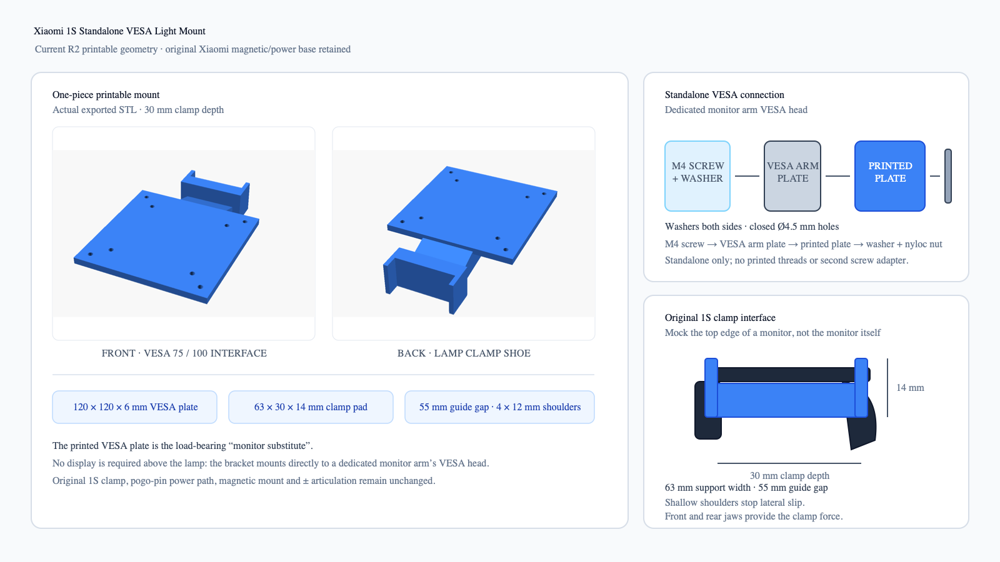

# Xiaomi 1S Monitor Light Mount

把小米米家屏幕挂灯 1S（MJGJD02YL）改造成独立显示器支架上的挂灯工位，当前主方案为：

1. 打印一块 `120 × 120 × 6 mm`、带真实 75 / 100 通孔的 VESA 转接板，并与承托臂做成同一个零件；
2. 立柱向右倾斜并直接并入 VESA 转接板左侧，再向反方向伸出一体承托臂，不增加独立连接脚或第二层托板；
3. 承托臂末端缩成 `63 × 30 × 14 mm` 的承托片，挡肩外沿与承托片两侧齐平；
4. 小米原装磁吸供电夹具的前卡扣和后弧形压脚从承托片前后外侧夹住它，灯条、供电和调角结构全部保留。

本项目的硬约束是保留小米原装夹具底座。1S 灯条通过底座供电，灯条本体虽然有两个触点，但不能把底座拆掉后直接给灯条接电。



当前 R2 方案直接连接独立显示器支架的 VESA 头；承托片模拟显示器上沿，并保留原装小米夹具、供电和调节结构。

## 当前状态

- 设计阶段：TX02 VESA 一体承托臂、三视图和交互 3D 已完成。
- 当前主方案：VESA 转接板与反方向一体承托臂一次打印成形，末端为短承托片；已取消底部水平条、中间托板、浅 U 槽和两根斜撑。
- R2 方向：侧视图中 VESA 转接板位于立柱右侧；蓝色承托臂与原装夹具向右展开，立柱左沿与承托片齐平。
- 已保留圆杆安装方向，但本轮图纸只展开 VESA / TX02 转接件。
- 未验证：底座左右宽度、卡扣前后夹持深度、可选的有效夹持高度、打印件强度和长期蠕变。

VESA 侧按固定 75 / 100 标准处理；每个挂灯型号只需填写 [通用测量表](docs/measurement-sheet.md) 中的底座宽度和卡扣深度，再把实测值固化到承托片参数。

## 图纸与 3D

[打开 TX02 VESA 一体承托臂三视图与交互 3D 模型 R2](docs/tx02-vesa-cradle-r2.html)

正式打印文件：[OpenSCAD 参数模型](cad/tx02_integrated_mount.scad) · [完整件 STL](exports/tx02_integrated_mount.stl) · [挡肩试片 STL](exports/tx02_fit_test.stl)

页面包含正视图、侧视图、俯视图、卡扣夹持剖面和可拖动 3D 模型。3D 模型使用 `0-100%` 结构分解滑杆，可分别查看 VESA 板、一体承托臂、承托片、1S 原装夹具和灯条；灯条可单独叠加检查整体比例。

## 设计原则

- 原装夹具整体保留，不拆、不改电路、不直接顶 pogo pin。
- VESA 转接板本身就是打印件，与蓝色承托臂在同一模型内一次成形；立柱向右倾斜并入 VESA 板左侧，VESA 板右沿与立柱根部齐平，两者之间用连续承力腹板补强，不在红色区域形成额外凸边。
- 承托片前后长度约 `30 mm`，正好铺在前卡扣与后压脚的内侧受力面之间；左侧前卡扣和右侧后压脚承担夹紧，右后脚主要起平衡作用。
- 承托片左右各向上延伸一条 `4 × 12 mm` 的挡肩，挡肩外沿与承托片外沿齐平并一次成形；两条挡肩内间距为 `55 mm`，相对 54 mm 底座给单边约 `0.5 mm` 装配余量。
- 不再使用 U 槽定位；原装底座的夹紧力直接作用在承托片前后边缘，承托片两侧留出足够空间供卡扣包住。
- 试片只需验证承托片长度、厚度和夹紧稳定性，不把原装塑料件硬撑变形。
- 独立 VESA 方案让灯跟随挂灯专用显示器支架升降、俯仰和旋转；圆杆方案只在需要摆开或侧照明时使用。
- 首件用 PETG 验证，正式承力件优先 PAHT-CF、PET-CF 或 MJF PA12；不推荐普通 PLA 长期受力。

## 目录

```text
.
├── README.md
├── assets/
│   ├── current-mount.png
│   ├── current-mount.svg
│   ├── concept.png
│   └── concept.svg
├── cad/
│   ├── README.md
│   ├── pole_1qtr_head.scad
│   └── vesa_mount.scad
├── docs/
│   ├── design-brief.md
│   ├── installation.md
│   ├── measurement-sheet.csv
│   ├── measurement-sheet.md
│   ├── sources.md
│   ├── tx02-vesa-cradle.html
│   └── tx02-vesa-cradle-r2.html
└── hardware/
    └── bom.md
```

## 关键事实

- 小米 1S 灯条长度：448 mm。
- 额定功率：5 W，输入 5 V / 1 A。
- 原装底座支持约 1 到 32 mm 的屏幕厚度。
- 原装底座提供磁吸固定、约 25 度旋转和约 40 度俯仰轴。
- 1S 底座不是简单方块。顶部横条水平放置，前压条和后弧形压脚向下展开，形成夹住显示器上沿的 L 型夹角。
- 灯条上有两个 pogo pin，供电通过原装底座完成。
- 松能 X / TX02 主臂标称承重 `2-12 kg`，附加臂最高 `7 kg`，支持 VESA 75 / 100。
- 社区 1S 底座外形参考约 `34.9 mm` 宽；本项目不再依赖约 `7 mm` 的中央卡口限位槽。

来源见 [docs/sources.md](docs/sources.md)。

## 下一步

1. 完成 [docs/measurement-sheet.csv](docs/measurement-sheet.csv)。
2. 用卡尺实测原装底座左右宽度和前后卡扣夹持深度。
3. 先只打印 `63 × 30 × 14 mm` 承托片试片，在 PETG 下检查前卡扣是否能落到板外侧并稳定夹紧。
4. 根据试片夹持松紧和旋转时的晃动修正承托片宽度、深度及挡肩间隙。
5. 完整件打印后先空载锁到独立支架的 VESA 头，检查螺丝锁紧、承托臂方向和线缆避让。

